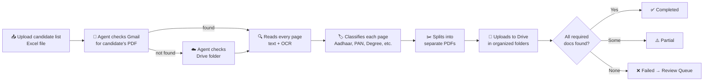
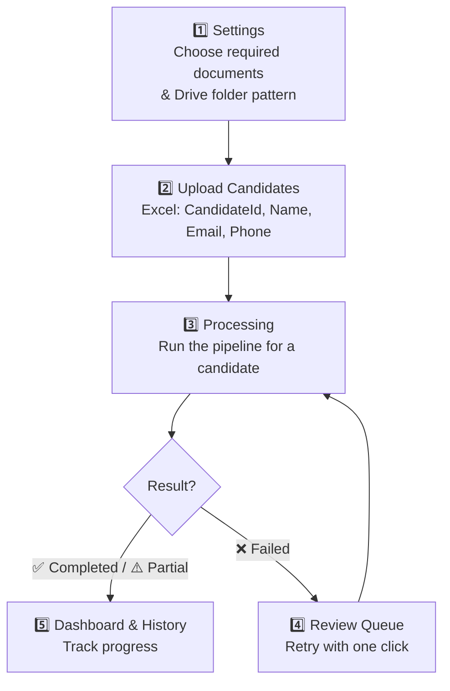

<div align="center">

# 📄 BGV Agent

### Automated Background Verification for Candidates

*Upload candidates → Agent fetches their documents → Classifies them with OCR → Organizes everything on Google Drive → Tracks status automatically*


</div>

---

## 🧐 What problem does this solve?

Verifying a new hire's documents normally means: someone manually opens their email, downloads a PDF, figures out which pages are which document, renames files, uploads them to the right folder, and updates a tracker by hand — for every single candidate.

**BGV Agent does all of that automatically.** You upload a list of candidates once, and the agent handles fetching, reading, sorting, and filing their documents — while you just watch the status update on a dashboard.

---

## 🎬 How it works (in plain English)



That's the entire pipeline — no manual sorting required.

---

## ✨ Features at a glance

| | Feature | What it means for you |
|---|---|---|
| 📥 | **Bulk upload** | Add hundreds of candidates in one Excel upload |
| 📧 | **Auto document fetch** | Pulls PDFs straight from Gmail (Drive folder as backup) |
| 🧠 | **Smart classification** | Reads scanned *and* digital PDFs, recognizes 30+ document types |
| ✂️ | **Auto-splitting** | One combined PDF → separate files per document type |
| ☁️ | **Organized Drive uploads** | Every file lands in a clean `Candidate → Category → File` structure |
| 📊 | **Live dashboard** | See Completed / Partial / Failed counts at a glance |
| 🔁 | **Review Queue** | One-click retry for anyone who failed the first pass |
| 🕓 | **Batch history** | Drill into any past batch and see exactly what happened |
| ⚙️ | **Fully configurable** | Change required docs and folder naming without touching code |

---

## 🗂️ What documents can it recognize?

The classifier reads the text on each page (using OCR for scanned pages) and matches it to one of these categories:

<table>
<tr>
<td valign="top" width="20%">

**🪪 Identity**
- Aadhaar
- PAN
- Passport
- Driving Licence
- Voter ID

</td>
<td valign="top" width="20%">

**🎓 Education**
- 10th Certificate
- 12th Certificate
- Degree Certificate
- Marksheet
- Provisional Certificate

</td>
<td valign="top" width="20%">

**💼 Employment**
- Offer Letter
- Appointment Letter
- Experience Letter
- Relieving Letter
- Payslip

</td>
<td valign="top" width="20%">

**💰 Financial**
- Form 16
- Bank Statement
- ITR
- Cancelled Cheque

</td>
<td valign="top" width="20%">

**🛡️ Compliance & More**
- Police Verification
- Drug Test
- NDA / BGV Consent
- Visa / Work Permit
- Utility Bills, Rental Agreement

</td>
</tr>
</table>

---

## 🏗️ Project structure

```
BVG--agent/
│
├── app.py                     🏠 Home page / entry point
├── requirements.txt           📦 Dependencies
│
├── data/
│   ├── bgv.db                 🗄️ SQLite database
│   └── settings.json          ⚙️ Required docs & Drive naming rules
│
├── database/
│   └── db.py                  🔧 All database read/write logic
│
├── services/
│   ├── gmail_service.py       📧 Connects to Gmail, fetches attachments
│   ├── drive_service.py       ☁️ Connects to Drive, creates folders, uploads
│   └── document_classifier.py 🔍 OCR + keyword-based page classification
│
├── pages/
│   ├── dashboard.py           📊 Status overview
│   ├── upload_candidates.py   📤 Bulk Excel upload
│   ├── candidates.py          👥 Full candidate list
│   ├── processing.py          ▶️ Run verification for one candidate
│   ├── review_queue.py        🔁 Retry failed candidates
│   ├── history.py             📜 Batch history + drill-down
│   └── settings.py            ⚙️ Configure everything
│
└── sample_files/
    └── sample_candidates.xlsx 📋 Example input format
```

---

## 🧭 The 5-step user journey



---

## 🚀 Getting started

### 1️⃣ Install the dependencies
```bash
pip install -r requirements.txt
```

### 2️⃣ Install Tesseract OCR
The classifier needs Tesseract installed locally for reading scanned documents. Update the path in `services/document_classifier.py` to match where it's installed on your machine.

### 3️⃣ Set up Google API access
- Enable the **Gmail API** and **Drive API** in a Google Cloud project.
- Download your OAuth `credentials.json` and place it in the project root.
- On first run, a browser window opens to authorize access — after that, a `token.json` keeps you signed in.

### 4️⃣ Launch the app
```bash
streamlit run app.py
```

---

## 📋 Excel input format

Your candidate list just needs these four columns:

| CandidateId | Name | Email | Phone |
|---|---|---|---|
| C101 | Satwik Sharma | satwik@example.com | 9876543210 |

*(See `sample_files/sample_candidates.xlsx` for a working example.)*

---

## 🧠 Under the hood: how a page gets classified

1. **Read the text** — PyMuPDF pulls native text from the PDF first (fast, accurate).
2. **Scanned page?** — If a page has no extractable text, it's converted to an image and run through **Tesseract OCR**.
3. **Match keywords** — The text is checked against a keyword library (e.g. `"uidai"` → Aadhaar, `"payslip"` → Payslip).
4. **File it correctly** — Each matched type is mapped to a Drive category, e.g. `PAN → Identity`, `Payslip → Employment`, `Court Record → Criminal`.

---

## ⚠️ Good to know

- 📌 The Tesseract path is currently set for **Windows** — update it if you're on macOS/Linux.
- 📌 Gmail lookup matches by candidate email and expects **one PDF attachment** per candidate.
- 📌 `services/candidate_service.py` is currently a placeholder — candidate logic lives in `database/db.py` for now.

---

<div align="center">

Built with ❤️ using Streamlit, Python, and the Google APIs — as part of an internship project at **Technossus**.

</div>
