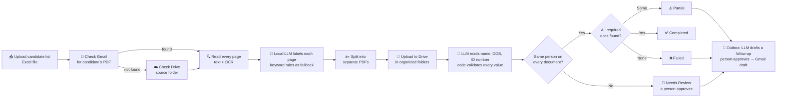
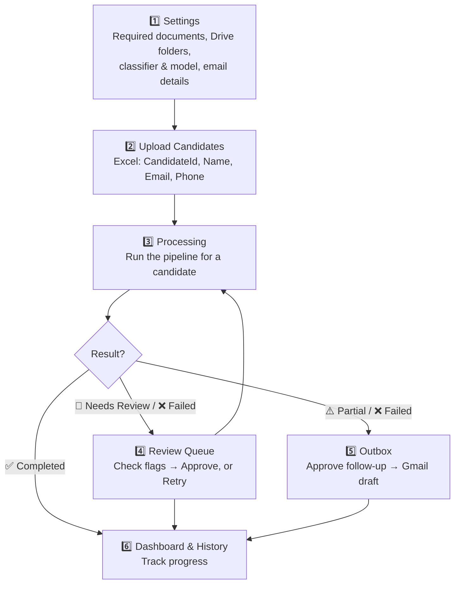

<div align="center">

# 📄 BGV Agent

### Automated Background Verification for Candidates, with a local LLM

*Upload candidates → Agent fetches their documents → A local LLM classifies every page and reads the key fields → Code checks the AI's work → Everything is filed on Google Drive → A person approves anything uncertain*


</div>

---

## 🧐 What problem does this solve?

Verifying a new hire's documents normally means: someone manually opens their email, downloads a PDF, figures out which pages are which document, renames files, uploads them to the right folder, checks that every document belongs to the same person, chases the candidate for whatever is missing, and updates a tracker by hand — for every single candidate.

**BGV Agent does all of that automatically.** You upload a list of candidates once, and the agent fetches, reads, sorts, checks and files their documents, and drafts the follow-up emails. A person only steps in when something needs a human decision.

---

## 🤖 The design idea: *the AI proposes, code checks, a person decides*

The app uses a **small language model that runs on the laptop itself** (`qwen3:4b` through [Ollama](https://ollama.com)):

- 🔒 **Private**: Aadhaar, PAN and other documents never leave the machine. No cloud AI API is called.
- 💸 **Free**: no per-page API cost.
- 🛟 **Never a single point of failure**: if Ollama isn't running or the model gives a bad answer, the app falls back to the original keyword and regex rules automatically.

The model is **never trusted on its own**. Every answer is forced into a fixed JSON shape, then checked by plain code. Anything uncertain goes to a person.

---

## 🎬 How it works (in plain English)



---

## ✨ Features at a glance

| | Feature | What it means for you |
|---|---|---|
| 📥 | **Bulk upload** | Add hundreds of candidates in one Excel upload |
| 📧 | **Auto document fetch** | Pulls PDFs straight from Gmail (Drive folder as backup) |
| 🤖 | **LLM page classification** | A local model labels every page by what it *is*, not what it *mentions* — so an offer letter saying "bring your Aadhaar" is still an offer letter |
| ✂️ | **Auto-splitting** | One combined PDF → separate files per document, front and back pages kept together |
| 🔎 | **Field extraction** | Reads name, date of birth, document number and issue date from each document |
| ✔️ | **Validators** | Aadhaar Verhoeff check digit, PAN format, "is this value really printed on the page?" |
| 🧑‍🤝‍🧑 | **Consistency checks** | Flags a sibling's PAN or a mismatched DOB, but accepts initials, dropped middle names and surname-first order |
| 🚩 | **Needs Review status** | Never marks a candidate Completed while their documents disagree |
| 📮 | **Follow-up Outbox** | The LLM drafts polite follow-up emails, code checks them, a person approves, and the app saves a **Gmail draft** (it never sends) |
| 🔐 | **Aadhaar masking** | Aadhaar numbers are checked in full, then stored only as `XXXX XXXX 1234` |
| ☁️ | **Organized Drive uploads** | Every file lands in a clean `Candidate → Category → File` structure |
| 📊 | **Live dashboard** | See Completed / Partial / Failed / Needs Review counts at a glance |
| 🔁 | **Review Queue** | Shows each flag, with **Approve** after a person checks and one-click **Retry** |
| 🕓 | **Batch history** | Drill into any past batch and see exactly what happened |
| ⚙️ | **Fully configurable** | Required docs, folder naming, classifier, model and email settings — all from the Settings page |

---

## 📈 Measured results

Every AI feature was measured against the original rules on a **synthetic test set**: fake candidates with known right answers, with the test documents worded differently from anything used for tuning.

| What was measured | Before (rules) | After (local LLM + code checks) |
|---|---|---|
| Pages labelled correctly | 66.0% | **97.9%** |
| Documents split out correctly | 22 / 45 | **40 / 45** |
| Candidate status correct | 7 / 10 | **10 / 10** |
| Field values read correctly (name, DOB, numbers, dates) | 74.1% (regex) | **100%** (116 / 116), 0 wrong values |
| Planted identity problems caught | — | **10 / 10**, 0 false alarms (exact matching: 10 false alarms) |
| Follow-up email drafts passing every check first try | — | **18 / 18** |

**Honest caveats:** the test set is small (47 test pages) and synthetic, so these numbers show the approach works on the cases it was built for. They're not a real-world accuracy rate. The LLM takes about 3.6 s per page against 0.74 s for keywords, on a laptop with an RTX 3050 Ti (4 GB).

What **didn't** work, also measured: the model's own confidence score (always about 0.95, right or wrong), its "thinking" mode (119 s and a wrong answer on one page), and a tool-calling agent for choosing follow-up actions (agreed with the rules on 1 of 45 scenarios, so plain rules decide).

👉 Full method, every number, and the limitations: [`eval/README.md`](eval/README.md)

---

## 🗂️ What documents can it recognize?

The classifier reads the text on each page (using OCR for scanned pages) and labels it as one of **32 document types** — or `unknown` for cover letters, blank pages and anything else that isn't a verification document:

<table>
<tr>
<td valign="top" width="20%">

**🪪 Identity**
- Aadhaar
- PAN
- Passport
- Driving Licence
- Voter ID

</td>
<td valign="top" width="20%">

**🎓 Education**
- 10th Certificate
- 12th Certificate
- Degree Certificate
- Marksheet
- Provisional Certificate

</td>
<td valign="top" width="20%">

**💼 Employment**
- Offer Letter
- Appointment Letter
- Experience Letter
- Relieving Letter
- Payslip

</td>
<td valign="top" width="20%">

**💰 Financial**
- Form 16
- Bank Statement
- ITR
- Cancelled Cheque

</td>
<td valign="top" width="20%">

**🛡️ Compliance & More**
- Police Verification
- Drug Test
- NDA / BGV Consent
- Visa / Work Permit
- Utility Bills, Rental Agreement

</td>
</tr>
</table>

---

## 🏗️ Project structure

```
BVG--agent/
│
├── app.py                      🏠 Home page / entry point
├── requirements.txt            📦 Dependencies
│
├── data/
│   └── settings.json           ⚙️ Required docs, Drive naming, model and email settings
│                                  (bgv.db is created here on first run — never committed)
│
├── database/
│   └── db.py                   🔧 All database read/write logic
│
├── services/
│   ├── pipeline.py             🏭 The full fetch → classify → split → upload → check flow
│   ├── gmail_service.py        📧 Gmail: fetch attachments, create drafts
│   ├── drive_service.py        ☁️ Drive: create folders, upload files
│   ├── document_classifier.py  🔍 Text + OCR reading, keyword rules, PDF splitting
│   ├── llm_client.py           🔌 Talks to Ollama: JSON schema, timeouts, fallbacks
│   ├── ai_classifier.py        🤖 LLM page classification
│   ├── extractor.py            🔎 LLM + regex field extraction
│   ├── validators.py           ✔️ Aadhaar / PAN / date checks, masking
│   ├── consistency.py          🧑‍🤝‍🧑 Same-person checks across documents
│   ├── followup.py             📮 Follow-up rules, LLM email drafting, email checks
│   └── followup_agent.py       🧪 Tool-calling agent experiment (not used by the app)
│
├── pages/
│   ├── dashboard.py            📊 Status overview
│   ├── upload_candidates.py    📤 Bulk Excel upload
│   ├── candidates.py           👥 Full candidate list
│   ├── processing.py           ▶️ Run verification for one candidate
│   ├── review_queue.py         🔁 Review flags, approve, or retry
│   ├── outbox.py               📮 Approve follow-up emails
│   ├── history.py              📜 Batch history + drill-down
│   └── settings.py             ⚙️ Configure everything
│
├── eval/                       📏 Synthetic test set + scripts that produce every number above
│   ├── README.md               📖 Method, results and limitations
│   └── results/                📄 Saved results (JSON)
│
└── sample_files/
    └── sample_candidates.xlsx  📋 Example input format
```

---

## 🧭 The user journey



---

## 🚀 Getting started

### 1️⃣ Install the dependencies
```bash
pip install -r requirements.txt
```

### 2️⃣ Install Tesseract OCR
The classifier needs Tesseract installed locally for reading scanned documents. Update the path in `services/document_classifier.py` to match where it's installed on your machine.

### 3️⃣ Install Ollama and the model (free, runs locally)
Install Ollama from [ollama.com](https://ollama.com), then download the model (about 2.5 GB):
```bash
ollama pull qwen3:4b
```
In the app, open **Settings → Test LLM connection** to check it works. A GPU helps but isn't required.

*Skipping this step?* The app still works: it falls back to the keyword and regex rules.

### 4️⃣ Set up Google API access
- Enable the **Gmail API** and **Drive API** in a Google Cloud project.
- Download your OAuth `credentials.json` and place it in the project root.
- On first run, a browser window opens to authorize access — after that, a `token.json` keeps you signed in.
- The app asks for permission to **read** Gmail, **create drafts** (for follow-ups — it never sends), and manage the Drive files it creates. If you authorized an older version, use **Settings → Reconnect Gmail** once.

### 5️⃣ Launch the app
```bash
streamlit run app.py
```

### 6️⃣ (Optional) Reproduce the measurements
```bash
python eval/generate_dataset.py
python eval/run_eval.py --split test --method keyword
python eval/run_eval.py --split test --method llm --model qwen3:4b
```
More commands are listed in [`eval/README.md`](eval/README.md).

---

## 📋 Excel input format

Your candidate list just needs these four columns:

| CandidateId | Name | Email | Phone |
|---|---|---|---|
| C101 | Satwik Sharma | satwik@example.com | 9876543210 |

*(See `sample_files/sample_candidates.xlsx` for a working example.)*

---

## 🧠 Under the hood: what happens to one page

1. **Read the text** — PyMuPDF pulls native text from the PDF first (fast, accurate).
2. **Scanned page?** — If a page has no text, it's rendered as an image and run through **Tesseract OCR**.
3. **Ask the local LLM** — The page text goes to `qwen3:4b` with a rulebook and the list of document types. The answer must be JSON in a fixed shape: the document's title as **evidence**, the **type** (only one of the allowed values), and whether the page **continues** the previous one (e.g. the back of an Aadhaar).
4. **Check the answer** — Code confirms the evidence is really printed on the page, and compares the label with the keyword rules. If they disagree, the log shows ⚠️ *please review*.
5. **Fall back if needed** — If the model fails, that page uses the keyword rules. After two failures in a row, the rest of the PDF uses keyword rules, so you never wait for repeated timeouts.
6. **Read the fields** — For each document, the LLM reads name, DOB, number and issue date. Code drops any value not printed on the page and flags any that break a format rule (e.g. a bad Aadhaar check digit).
7. **File it correctly** — Each document is mapped to a Drive category, e.g. `PAN → Identity`, `Payslip → Employment`.

---

## ⚠️ Good to know

- 📌 The Tesseract path is currently set for **Windows** — update it if you're on macOS/Linux.
- 📌 Gmail lookup matches by candidate email and uses the **newest email with a PDF**.
- 📌 Two documents of the same type placed right after each other (e.g. two payslips) are sometimes merged into one file.
- 📌 The duplicate check works by **document type**, so a corrected re-upload of the same type is skipped — remove the old one first.
- 📌 Creating Gmail drafts has only been tested against a stand-in Gmail service, not a real account.
- 📌 `services/candidate_service.py` is currently a placeholder — candidate logic lives in `database/db.py` for now.
- 📌 Never commit `data/bgv.db`, `uploads/`, `credentials.json` or `token.json` — they hold real candidate data or secrets, and `.gitignore` excludes them.

---

<div align="center">

Built with ❤️ using Streamlit, Python, Ollama, and the Google APIs — as part of an internship project at **Technossus**.

</div>
